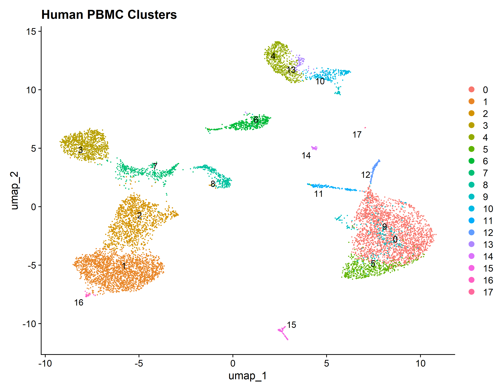

# Single-Cell RNA-seq Analysis of Human PBMCs Using Seurat

## Project Overview

This project analyzes single-cell RNA sequencing (scRNA-seq) data from healthy human peripheral blood mononuclear cells (PBMCs) using the Seurat R package.

The main objective is to identify and characterize immune cell populations based on gene expression profiles.

## Dataset

- Dataset: 10x Genomics Human PBMC 10k (v2)
- Sample: One healthy donor
- Data type: 10x Genomics gene expression matrix

## Analysis Workflow

1. Data loading and Seurat object creation
2. Quality control (QC) and cell filtering
3. Data normalization
4. Identification of highly variable genes
5. Principal Component Analysis (PCA)
6. Cell clustering
7. UMAP dimensionality reduction and visualization
8. Cluster marker identification
9. Exploratory cell type annotation
10. Doublet detection using DoubletFinder

## Key Results

- 10,041 cells passed the quality control filtering criteria.
- 2,000 highly variable genes were identified.
- 18 cell clusters were identified.
- Immune cell populations were explored using canonical marker genes.
- DoubletFinder predicted 502 potential doublets using an assumed doublet rate of 5%.

## Cell Type Annotation

Clusters were annotated using canonical marker genes and exploratory marker analysis. Some clusters showed ambiguous or mixed expression profiles and were therefore not assigned definitive cell identities.

## Limitations

- The analysis includes one healthy donor.
- Cell type annotations are exploratory and based on marker gene expression.
- DoubletFinder predictions depend on the assumed doublet rate and should not be considered definitive.
- No case-control comparison or inferential differential expression analysis was performed.

## Tools and Packages

- R
- RStudio
- Seurat
- DoubletFinder

## Data Source

The dataset is publicly available from 10x Genomics: https://www.10xgenomics.com/datasets

## UMAP Visualization

The UMAP plot shows the distribution of cells across the identified clusters.

